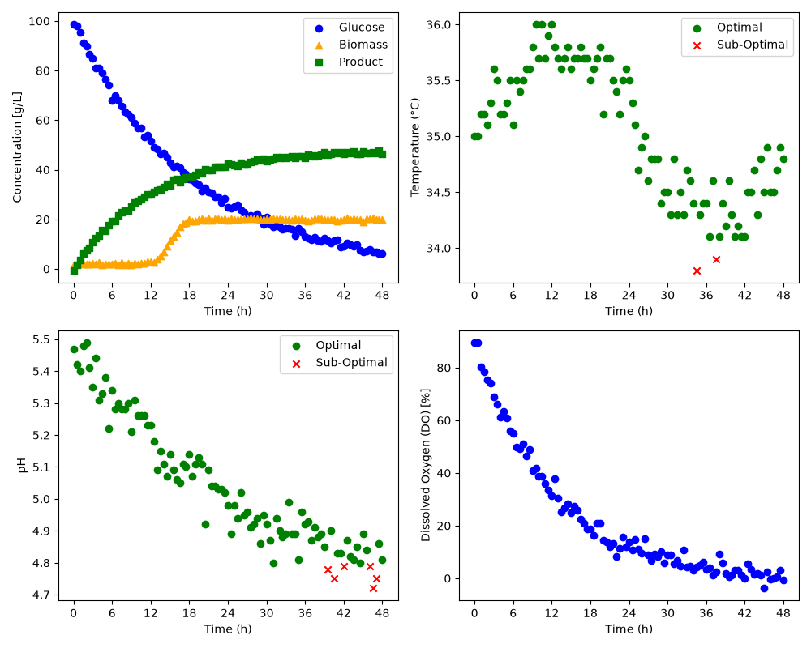

# Fermentation Process Monitoring and Analysis

## Overview

This Python class is designed to monitor a fermentation process to ensure that variables such as pH and temperature remain within acceptable operating limits. These parameters are vital for the bioprocess as they can strongly influence cell growth and productivity. This project therefore aims to support process monitoring and troubleshooting by generating dashboard figures and batch-level summary tables.

### Features
- Imports fermentation data from a CSV file.
- Analyzes individual batches and compares temperature and pH values to acceptable operating limits.
- Generates detailed monitoring dashboards illustrating key process parameters and highlighting suboptimal results to facilitate troubleshooting.
- Creates summary tables with key process information for each batch including the percentage of optimal pH and temperature values, and the final concentration of the product.

### Technologies used
- Python 3.14.7
- pandas 3.0.5
- matplotlib 3.11.0

### Code design
When main.py is executed:
- The fermentation data is imported from the dataset. 
- A BioprocessMonitor object is created for the two modes, with each mode associated with different pH and temperature limits.
- Each batch is extracted and analyzed to determine whether the pH and temperature measurements are within the acceptable range.
- The dashboard figures shown below are generated for each batch.
- Summary tables are generated for both modes.
- The dashboard and summary tables are saved to the figures directory and tables directory, respectively.

## Dashboard

### Batch 1 Dashboard (MODE A)

The dashboard illustrates the key performance parameters for a given fermentation batch. The top left subplot shows the concentration of glucose, biomass, and product as a function of fermentation time, while the three other subplots illustrate pH, temperature, and dissolved oxygen. Measurements that are outside the acceptable ranges are highlighted to facilitate process monitoring and troubleshooting. 

## Summary table

### Mode A Batch Summary
| batch_id | ph_optimal_percent | temperature_optimal_percent | C_product_g_L^-1_final |
|----------|--------------------|-----------------------------|------------------------|
| 1        | 93.81              | 97.94                       | 46.5                   |
| 2        | 96.69              | 97.52                       | 50.8                   |
| 3        | 95.89              | 93.15                       | 44.6                   |
| 4        | 100.0              | 96.47                       | 48.6                   |
| 5        | 48.62              | 99.08                       | 24.7                   |

The summary table reports batch-level results under mode A. The pH_optimal_percent and temperature_optimal_percent columns indicate the percentage of pH and temperature measurements that were within the acceptable limits. C_product_g_L^-1_final shows the final product concentration achieved at the end of each fermentation batch.  